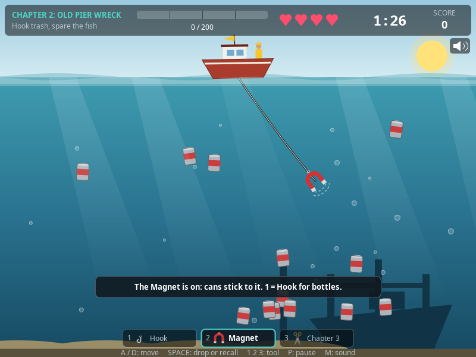
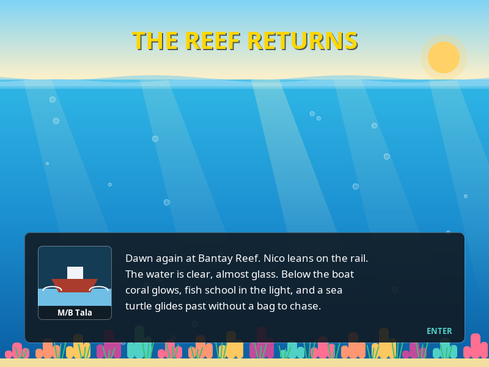
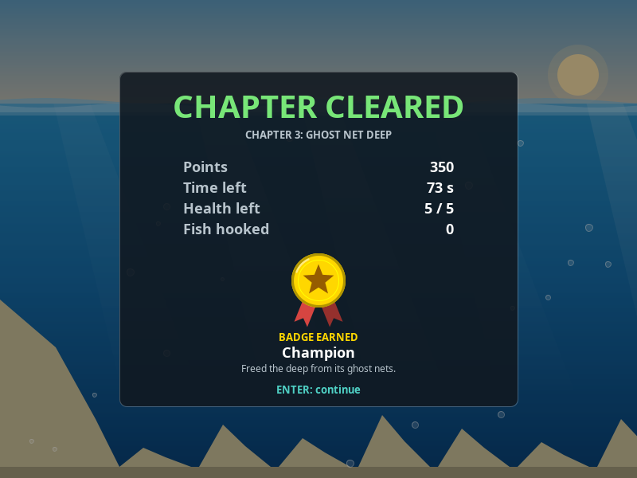
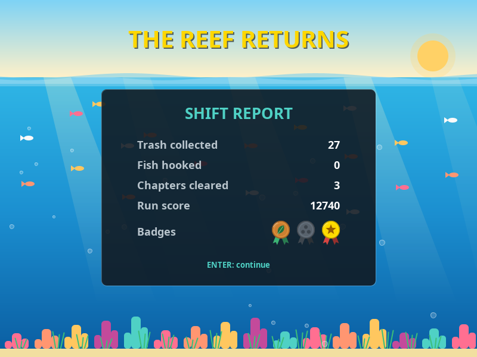
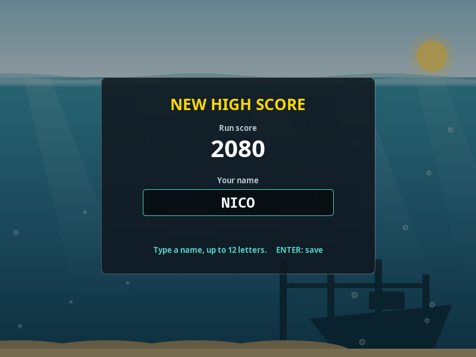
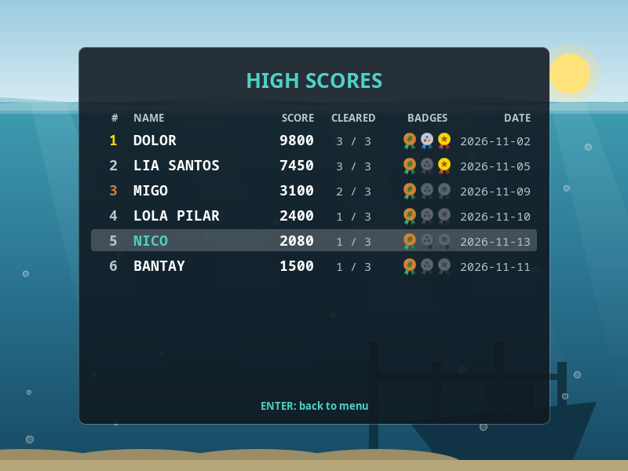

# FISH2TRASH

Hook the trash. Spare the fish. Save the reef.

A 2D story game in Java Swing. You play Nico Abella, the newest member of Captain
Dolor's clean-up crew at Bantay Reef. Each chapter has a quota of trash to collect
before time or health runs out, and each kind of trash needs its own tool. Clear all
three chapters and the reef comes back to life.

| | |
|---|---|
|  |  |
|  |  |
|  |  |
|  |  |
|  |  |

Team project for CIS 2103 (Object Oriented Programming), University of San Carlos.

## Requirements

JDK 17 or newer. Check yours with `java -version`. No libraries needed.

## Run

| | Linux / macOS | Windows |
|---|---|---|
| Play the game | `scripts/run.sh` | `scripts\run.bat` |
| Only compile | `scripts/build.sh` | `scripts\build.bat` |
| Run the tests | `scripts/test.sh` | `scripts\test.bat` |

The scripts work from any folder. They look for a JDK 17+ in `JAVA_HOME` first,
then on the `PATH`, and stop with "Need JDK 17+" if there isn't one.

To build by hand instead, from the project folder:

```bash
mkdir -p out
javac --release 17 -d out $(find src -name '*.java')
java -cp out Main
```

## Controls

| Key | Action |
|---|---|
| `A` / `D` or arrow keys | Move the boat (only while the hook is swinging) |
| `Space` | Drop the hook. Press again while it is going out to pull it back |
| `1` `2` `3` | Put the Hook, Magnet or Net Cutter on the line (only while it swings) |
| `Q` / `E` | Previous / next tool |
| `H` | Show the last tip or hint again |
| `P` or `Esc` | Pause (resume, sound on or off, restart the chapter, or quit to the menu) |
| `M` | Sound on or off, on any screen (except while typing a name) |
| Letters, `Backspace`, `Enter` | Type and save your name when a run makes the high-score list |
| `Enter` | Confirm, next story page |
| `Esc` on a story page | Skip the story |
| `Up` / `Down` | Move in menus |

## How to play

| Chapter | Trash to look for | New tool | Quota | Time | Health |
|---|---|---|---|---|---|
| 1. Plastic Shallows | bottles (10 points) | Hook | 100 | 80 s | 3 |
| 2. Old Pier Wreck | cans (20), bottles | Magnet | 200 | 90 s | 4 |
| 3. Ghost Net Deep | fishing nets (50), cans, bottles | Net Cutter | 350 | 105 s | 5 |

What each tool does:

| Tool | Bottle | Can | Net | Fish |
|---|---|---|---|---|
| Hook | catches | slips off | slips off | hooks it (costs health) |
| Magnet | passes through | catches | passes through | passes through |
| Net Cutter | slips off | slips off | catches | hooks it (costs health) |

- A chapter starts with its new tool on the line. Change tools only while the line is
  swinging, and at most once a second.
- When trash slips off the wrong tool, the throw is wasted but no health is lost.

- Hooking a fish costs 1 health and the fish swims away. Pufferfish and barracuda
  (chapter 3) cost 2. A pufferfish swells when the hook is near; a barracuda
  flashes, then charges.
- Reaching the quota stops the clock. The chapter is cleared when that catch
  reaches the boat.
- Run out of time or health and you are fired. You can retry the chapter;
  chapters you already cleared stay cleared.
- The game gives a hint when you keep making the same mistake: three fish in a row,
  two slips off the wrong tool, twelve seconds without dropping the line, little time
  with less than half the quota, or your last health. At most three hints per chapter,
  at least 20 seconds apart.
- Each chapter has a badge. The chapter report shows it, earned or missed, and the
  shift report at the end shows all three.

| Badge | Chapter | How to earn it |
|---|---|---|
| Eco Rookie (bronze) | 1 | Clear the chapter |
| Sorter (silver) | 2 | Clear it with at most 1 slip off the wrong tool, and at least 6 of every 10 throws bringing up trash |
| Champion (gold) | 3 | Clear it with at least 40% of the time left and at most 1 health lost |

### Score and high scores

When a run ends (the story is finished, or you are fired and press `Esc`), it gets a
run score:

| What | Worth |
|---|---|
| Each point of trash in a cleared chapter | 10 |
| Each whole second left on the clock of a cleared chapter | 20 |
| Each health left at the end of a cleared chapter | 100 |
| Badges | Eco Rookie 300, Sorter 500, Champion 1000 |
| Failed attempts | minus 500 for the first, 1000 more for the second, 1500 more for the third, ... |

The score never goes below zero. The chapter report shows what the chapter was worth.

The ten best runs are kept on the High Scores page of the menu. A run that makes the
list asks for a name (up to 12 letters; leave it empty for "NICO"). The list is saved
in `.fish2trash/highscores.txt` in your home folder; delete that file to start a new
list. If the file cannot be written the game still works, and the list then lasts
until the game closes.

## Folder structure

```
FISH2TRASH/
├── src/
│   ├── Main.java            opens the window on the Swing thread
│   ├── model/               the things in the game - no drawing code
│   │   ├── OceanObject      abstract base: position, movement, collision
│   │   ├── OceanTrash       abstract: gives points, rides the hook
│   │   │   └── PlasticBottle, Can, FishingNet
│   │   ├── Fish             abstract: costs health, swims away
│   │   │   └── SmallFish, BigFish, Pufferfish, Barracuda
│   │   ├── ObjectKind       enum: builds each object, lookup key for painters
│   │   ├── ObjectView, HookSensor   small read-only interfaces
│   │   ├── Player, Boat, Hook, TimeLimit
│   │   ├── Equipment        abstract tool on the line
│   │   │   └── PlainHook, Magnet, NetCutter
│   │   ├── EquipmentType    enum: builds each tool, knows its chapter
│   │   ├── Loadout, EquipmentLockedException   the crew's tools and the swap rules
│   │   ├── CatchOutcome, CatchResolver
│   │   └── Level, ChapterData, SpawnRule, TutorialPrompt   the chapters as data
│   ├── game/                the rules
│   │   ├── GameManager      one chapter attempt: collisions, quota, win/lose
│   │   ├── GameSession      the whole run: current chapter, cleared chapters, badges, retries
│   │   ├── GameView         what the screen may read from a game
│   │   ├── ChapterResult, ChapterStatus, FailCause, SessionStats, GameState
│   │   ├── Badge            enum: one badge per chapter, each with its own rule
│   │   ├── ScoreCalculator  the run score: chapters, badges, failed attempts
│   │   ├── ScoreEntry, HighScoreTable   one line of the high-score list, and the list
│   │   ├── GameEvent, EventType, GameListener   (observer pattern)
│   │   ├── HintEngine       decides when the player gets a hint
│   │   └── HintRule         interface, one small class per reason for a hint:
│   │                        FishStreakRule, SlipStreakRule, IdleRule, LowTimeRule, LowHealthRule
│   ├── ui/                  the screens
│   │   ├── GamePanel        frame timer and keyboard
│   │   ├── ScreenManager    which screen is showing, fades between them
│   │   ├── Screen           interface every screen implements
│   │   ├── AudioEventListener   picks the sound for each game event
│   │   ├── MainMenu, HowToScreen, StoryScreen, GameScreen, PauseOverlay,
│   │   │   ChapterClearScreen, GameOverScreen, VictoryScreen, NameEntryScreen,
│   │   │   HighScoreScreen
│   │   └── render/          SceneRenderer, HudPainter, EffectsSystem, backgrounds and
│   │                        water, one painter per object kind and per tool, BadgePainter
│   └── util/
│       ├── GameConstants    every tuning number in one place
│       ├── StoryText        every line of text the player reads
│       ├── Mathx            clamp, lerp, easing
│       ├── HighScoreStore, HighScoreException   the score file, and what goes wrong with it
│       ├── ToneSynth        turns a recipe of tones into sound samples
│       ├── SoundEffect      enum: one recipe per sound in the game
│       └── AudioPlayer      interface: SynthAudioPlayer (real), SilentAudioPlayer (no sound)
├── test/                    tests, run by scripts/test
├── docs/                    class diagram, screenshots, playtest sheet, proposal notes
├── scripts/                 build, run and test (.sh and .bat)
├── out/                     compiled game (created by the build, not in git)
└── out-test/                compiled tests (not in git)
```

A class diagram is in [docs/class-diagram.md](docs/class-diagram.md).

## How the classes work together

1. `Main` builds a `JFrame` on the event-dispatch thread and adds a `GamePanel`.
2. `GamePanel` runs a `javax.swing.Timer` (~60 fps). Every tick it measures the real
   time since the last tick (`dt`) and passes it, and any fresh key press, to the
   `ScreenManager`. Painting only *reads* the game.
3. `ScreenManager` holds one `Screen` per `GameState` and the `GameSession` (the run).
4. `GameScreen` asks the session for a `GameManager` for the current chapter.
5. `GameManager` owns the `Player`, the `Boat` (which owns the `Hook`), a `TimeLimit`
   and a `Level`. The `Level` reads the chapter's spawn table from `ChapterData` and
   keeps the water stocked.
6. When the hook tip touches an object, the tool on the line (`Equipment`) answers with
   a `CatchOutcome`: catch, slip or pass. The outcome calls back into the manager.
7. On a catch the manager calls `object.onCaught(player, hook)`. Trash adds points and
   attaches itself to the hook; a fish costs health and swims away. The manager never
   checks which one it was.
8. The manager announces what happened as `GameEvent`s to its `GameListener`s
   (the stats counter, the effects, the sounds, and the screen that shows tips).
   The `HintEngine` reads the stats and, when a `HintRule` is triggered, a hint goes out
   as one more event.
9. When the chapter ends, the session records a `ChapterResult`, asks the chapter's
   `Badge` whether that result earns it, and the screens move on: report card and next
   chapter after a clear, pink slip and retry after a fail.
10. When the run ends, `ScoreCalculator` works out the run score. If the
    `HighScoreTable` has room for it, `NameEntryScreen` asks for a name and adds a
    `ScoreEntry`; the table sorts itself and saves through `HighScoreStore`.

### OOP concepts, and where to point at them

| Concept | Where |
|---|---|
| Encapsulation | Every field is private. `Player` only changes through `addPoints()` and `loseHealth()`, which enforce the rules. Lists are handed out read-only. |
| Inheritance | `OceanObject` → `OceanTrash` → `PlasticBottle`, `Can`, `FishingNet`, and `OceanObject` → `Fish` → `SmallFish`, `BigFish`, `Pufferfish`, `Barracuda`. `Equipment` → `PlainHook`, `Magnet`, `NetCutter`. |
| Abstraction | `OceanObject`, `OceanTrash`, `Fish` and `Equipment` are abstract. `GameView`, `ObjectView`, `HookSensor`, `Screen`, `GameListener`, `CatchResolver`, `HintRule`, `ObjectPainter`, `ToolPainter` and `AudioPlayer` are interfaces that hide what is behind them. |
| Polymorphism | `object.onCaught(player, hook)`, `object.move(dt)` and `object.sense(hook)` (a pufferfish weaves and swells, a barracuda charges), `tool.attempt(object)`, `outcome.resolve(...)`, `rule.isTriggered(stats, game)`, `badge.isEarnedBy(result)`, `screen.paint(g)`, `painter.paint(...)`: one call, different behaviour per class. |
| Composition | `Boat` owns its `Hook`; the `Hook` carries a `Loadout` of tools; `GameManager` owns a `Level`. |
| Custom exception | `Loadout.select()` throws the checked `EquipmentLockedException` for a tool the crew does not have yet. `GameManager.selectTool()` catches it and turns it into a message on screen. `HighScoreStore` and `ScoreEntry.parse()` throw the checked `HighScoreException` (it wraps the `IOException`); `HighScoreTable` catches it, skips a damaged line or carries on without the file. |
| Comparable and collections | `ScoreEntry implements Comparable<ScoreEntry>`, so `Collections.sort` orders the list. `ArrayList` for lists, `EnumMap` and `EnumSet` for lookups and sets keyed by an enum. |
| File I/O | `HighScoreStore` reads and writes the score file with `java.nio.file`, writing a draft first and swapping it in. |
| Enums with behaviour | `ObjectKind.create()` and `EquipmentType.create()` build their own objects; `CatchOutcome.resolve()` calls the right method; each `Badge` constant carries its own rule. No `switch` over types. |

Patterns used: observer (`GameListener`), template method (`OceanObject.update`,
`Equipment.attempt`, `Badge.isEarnedBy`), strategy (`HintRule`: the engine runs a list of interchangeable
rules), a state machine per screen (`ScreenManager`) and inside
`Hook` and `Barracuda`, null object (`SilentAudioPlayer` stands in when there is no
sound device or in tests).

Design rules, checked by `ArchitectureTest` on every test run: `model` and `game` have
no drawing, window or sound imports; nothing uses `instanceof`; no public fields
except constants.

## Testing

`scripts/test.sh` (or `scripts\test.bat`) builds the game and runs every test. The
tests are plain Java classes with a `run()` method, listed in `test/TestRunner.java`;
no test library is needed. The script exits with an error if any check fails.

| Test | What it checks |
|---|---|
| `ArchitectureTest` | The design rules above, by reading the source files |
| `PlayerTest`, `OceanObjectTest`, `BoatHookTest` | Health and score rules, movement, bouncing, collision, the hook's swing, launch and recall |
| `ModelCatchTest`, `DangerousFishTest` | What each kind of object does when hooked; pufferfish and barracuda behaviour |
| `EquipmentMatrixTest` | Every cell of the tool table above: three tools against seven kinds of object |
| `EquipmentTest`, `LoadoutTest` | How a slip plays out; which tools each chapter has; the swap rules (locked tool, wait, not while the line is out) |
| `HintTest` | Each hint rule fires exactly at its threshold; the most urgent hint goes first; 20 seconds between hints; three per chapter at most |
| `BadgeTest` | Each badge just inside and just outside its limits; the badges a clean, a sloppy and a retried run collect; the medal and its chime on the chapter report |
| `GameEventTest`, `ChapterFlowTest` | The events the game announces; winning, the frozen clock, and both ways to lose |
| `LevelSpawnTest` | Spawn tables: timing, counts, distance from the hook, and enough trash to finish |
| `SessionTest` | Moving on after a clear, retrying after a fail |
| `ScoreFlowTest` | What a chapter, a badge and a failed attempt do to the run score, checked against the numbers in `GameConstants` |
| `HighScoreStoreTest` | Tidy names; the line format of the score file; the order and length of the list; a restart, a damaged file and a failed save. Uses temporary folders, never your real list |
| `HighScoreScreenTest` | When a name is asked for, what can be typed, and that the run lands on the list and in the file |
| `BalanceBotTest` | A simple computer player, changing tools as needed, must be able to win every chapter at least half the time, and to earn each badge. A second, careless one (slow, with poor aim) must hardly ever run out of time |
| `StoryTextTest` | Every story page, fail message and tip fits its box |
| `ScreenFlowTest` | Key presses lead to the right screens: menu, how to play, high scores, story, pause, fired screen, retry |
| `SynthTest` | Each sound has the right length and pitch, starts and ends quietly, and comes out the same every time; the player stays silent without a sound device |
| `AudioEventTest` | The right sound for each game event; ten clock ticks in the last ten seconds |
| `RenderTest`, `EffectsTest`, `MathxTest` | Drawing into an off-screen image, each chapter's look, the bubble and effect pools; the math helpers |

The tests cannot judge how the game feels or sounds. Use the checklist below for that,
and [docs/playtest.md](docs/playtest.md) when you tune the numbers.

## Manual testing checklist

**Menus and story**
- [ ] The game opens on the menu. Up/Down move, Enter selects.
- [ ] How to Play opens and Enter returns.
- [ ] Start shows the opening and chapter 1 story. Enter finishes a page, then turns it.
- [ ] Esc skips the story.

**Boat and hook**
- [ ] `A`/`D` and the arrow keys move the boat; it stops near both screen edges.
- [ ] The boat cannot move while the hook is out.
- [ ] `Space` launches the hook straight along its swing angle.
- [ ] `Space` again while it is going out pulls it back empty.
- [ ] Holding `Space` down does not pull the hook back by itself.

**Chapter 1**
- [ ] Bottle +10; it rides the hook up and a new one appears.
- [ ] A fish costs 1 health, gives no points, and swims away.
- [ ] Tips appear at about 1, 8 and 16 seconds.
- [ ] At 100 points the timer stops; the chapter clears when the catch reaches the boat.

**Chapter 2**
- [ ] The story ends with a NEW GEAR page; the Magnet is on the line at the start.
- [ ] Health 4, time 1:30. Cans are worth 20; most sit low on the right.
- [ ] The Magnet lifts cans and goes straight through fish and bottles.
- [ ] `1` puts the Hook on: it catches bottles, and cans slip off it (sparks, no health lost).
- [ ] A second tool change within a second is refused. So is one while the line is out.
- [ ] `3` shows "The Net Cutter arrives in chapter 3."
- [ ] Big blue fish are clearly faster.

**Chapter 3**
- [ ] The Net Cutter is on the line at the start. Health 5, time 1:45. Nets are worth 50.
- [ ] Cans and bottles slip off the Net Cutter; it still hooks fish.
- [ ] `Q` and `E` step through all three tools.
- [ ] A pufferfish swells when the hook is near. Hooking it costs 2.
- [ ] A barracuda flashes, then charges. Hooking it costs 2.
- [ ] Clearing it shows the ending, then the shift report, then the name entry.

**Losing and pausing**
- [ ] Time running out shows the pink slip with a "tide" or "time" message.
- [ ] Health reaching 0 shows the pink slip with a "fish" message.
- [ ] Enter retries the same chapter; Esc ends the run (menu, or the name entry if the
      run scored enough for the list).
- [ ] `P` or `Esc` pauses. Resume, Restart chapter and Quit to menu all work.
- [ ] Clicking another window pauses the game.

**Hints**
- [ ] Wait 12 seconds without dropping the line: "Still there? ..." appears.
- [ ] Hook three fish in a row (chapter 3 has the health for it): a hint about fish appears.
- [ ] In chapter 2, hit cans with the Hook twice: "Metal cans: use the Magnet (2)."
- [ ] On the last health: "Last health! ..."
- [ ] `H` shows the last tip or hint again.
- [ ] Never more than three hints in one chapter attempt.

**Badges**
- [ ] Clearing chapter 1 always shows the bronze Eco Rookie medal: it pops in with
      sparkles and a two-note chime.
- [ ] Chapter 2 with two or more slips, or mostly missed throws: grey medal, "BADGE MISSED".
- [ ] Chapter 2 played cleanly: the silver Sorter medal.
- [ ] Chapter 3 cleared fast with at most 1 health lost: the gold Champion medal.
- [ ] The shift report at the end shows the three medals, the missed ones in grey.

**High scores**
- [ ] The menu's High Scores page opens; with no file yet it says "No scores yet".
- [ ] The chapter report shows a chapter score.
- [ ] Finish the story: the shift report shows the run score, then the name entry appears
      with a short fanfare.
- [ ] Typing shows capital letters; `Backspace` deletes; no more than 12 fit; typing an
      `M` does not switch the sound.
- [ ] `Enter` saves and shows the list with your run picked out. Empty name: "NICO".
- [ ] Close the game and start it again: the run is still on the list.
- [ ] Clear chapter 1, get fired in chapter 2 and press `Esc`: the name entry appears too.
- [ ] Get fired in chapter 1 without clearing anything and press `Esc`: straight to the menu.

**Sound**
- [ ] Dropping the hook, each kind of trash, a fish hit, reaching the quota, clearing
      and failing a chapter each make their own sound. So do changing a tool, a new
      tool, a tip, a badge and a new high score.
- [ ] The clock ticks during the last 10 seconds, higher in the last 5.
- [ ] `M` turns sound off and on at once; the speaker icon under the score follows.
- [ ] With no speakers or headphones the game still runs, silent.

## Team

LangoyLaban, BSIT 2.

| Member | Area |
|---|---|
| Matthew Llenos | Player, chapters and levels, game manager and session, timer, win and lose, HUD, story, hints, badges, score and high scores |
| Arjoe R. Marata | Boat, hook and tools, controls, collision, screens and animation, sound |
| Neil Villarito | Ocean objects, trash and fish classes, spawning, object painters, the test suite and the balance bot |

## Credits

Everything on screen is drawn in code with Java2D, every sound is built from sine,
triangle and square waves in code (`javax.sound.sampled`), and all text is written by
the team. The game uses no external images, fonts, sound files or libraries.

## Contributing

- Work on a branch, not on `main`. Name it `<type>/<short-name>`, for example
  `feat/boat-movement` or `fix/hook-collision`.
- Run the tests before you commit (`scripts/test.sh` or `scripts\test.bat`).
  The build must finish with no warnings.
- Keep commits small, one change each. Start the message with a type and write
  it as an instruction, in lowercase: `feat: add boat movement`,
  `fix: stop hook passing through cans`. Types: `feat`, `fix`, `refactor`,
  `test`, `docs`, `chore`, `build`.
- Push your branch and open a pull request into `main`, then ask a teammate to
  review it.
