# FISH2TRASH

Hook the trash. Spare the fish. Save the reef.

A 2D story game in Java Swing. You play Nico Abella, the newest member of Captain
Dolor's clean-up crew at Bantay Reef. The story has three chapters of five levels.
Each level has a quota of trash to collect before time or health runs out, each kind
of trash needs its own tool, and every tool is a danger to the fish. Clear all
fifteen levels and the reef comes back to life.

| | |
|---|---|
| 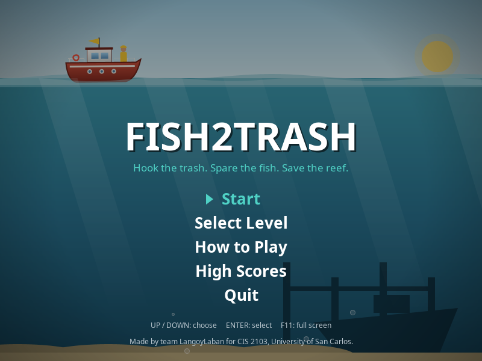 | 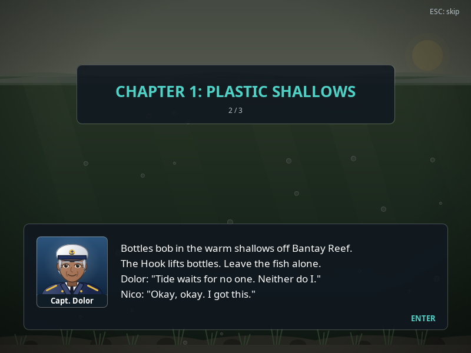 |
| 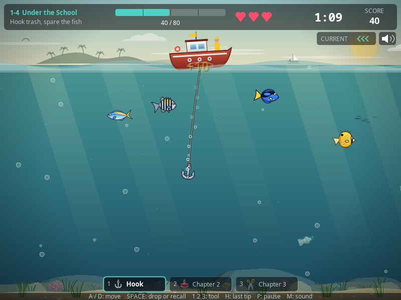 | 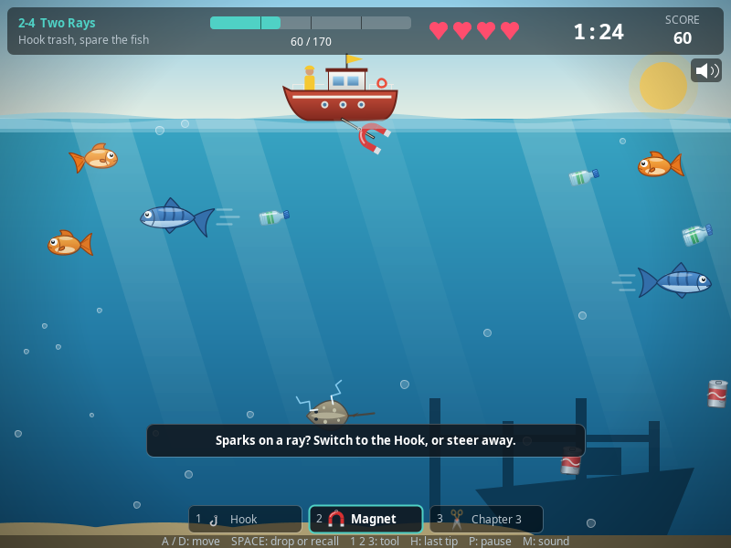 |
| 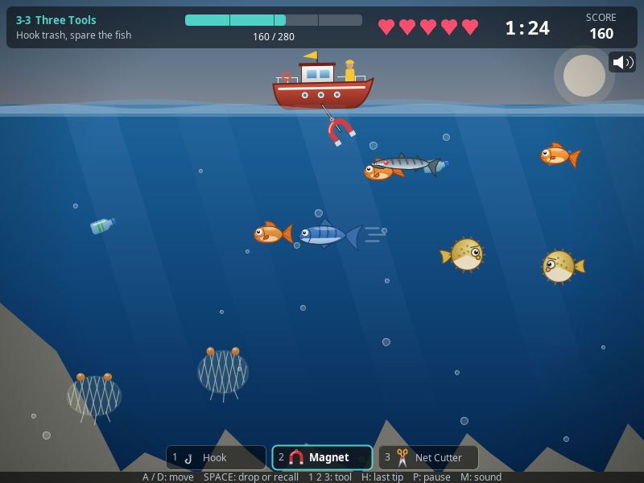 | 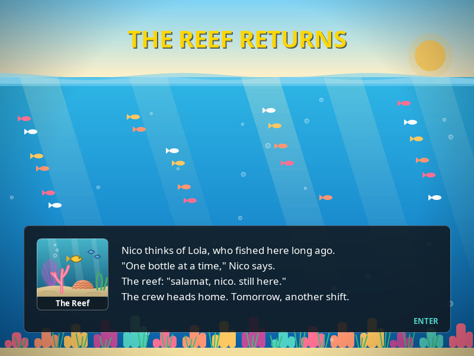 |
| 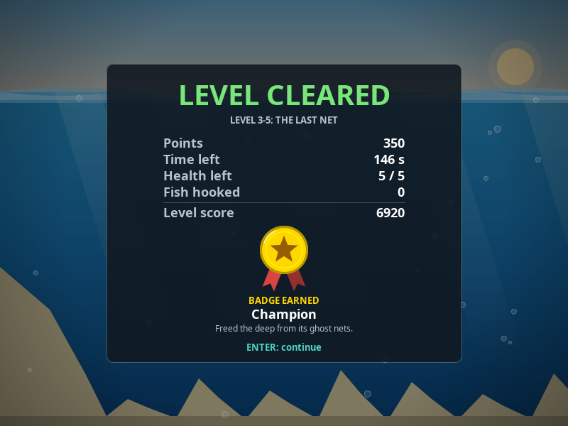 | 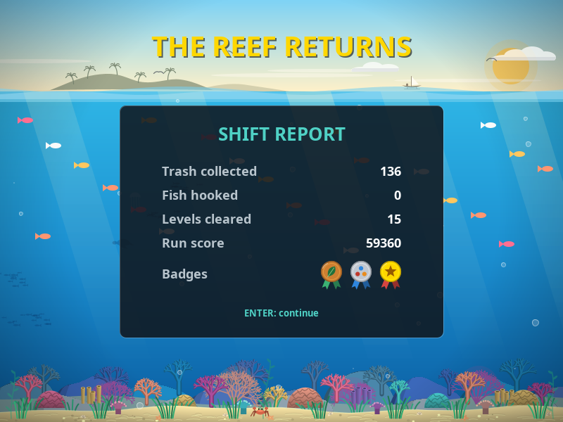 |
| 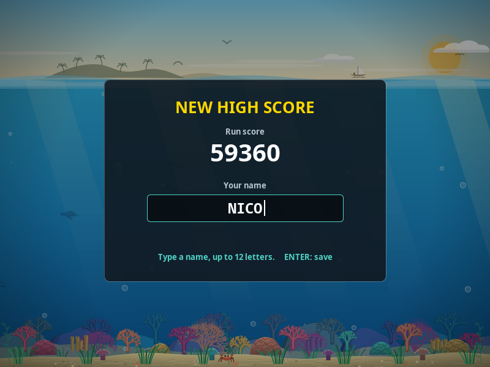 | 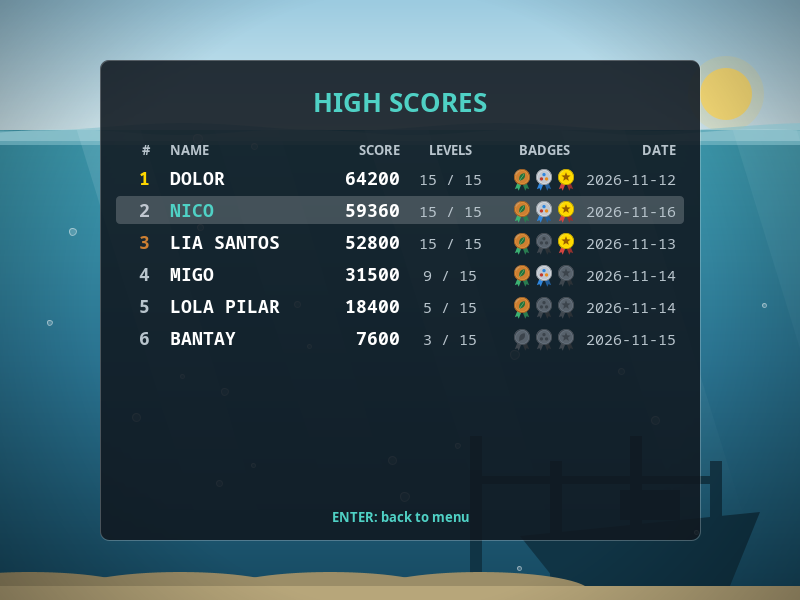 |
| 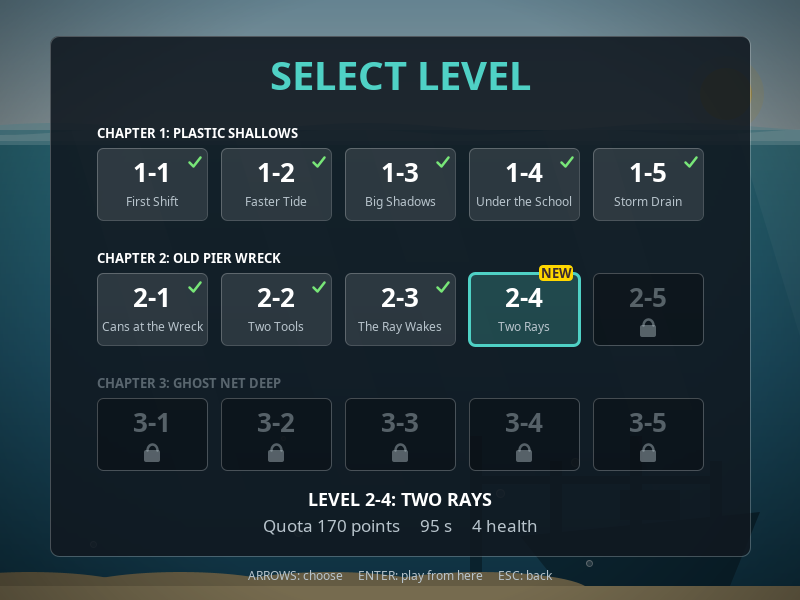 | |

Team project for CIS 2103 (Object Oriented Programming), University of San Carlos.

## Requirements

JDK 17 or newer. Check yours with `java -version`. No libraries needed.

## Run

| | Linux / macOS | Windows |
|---|---|---|
| Play the game | `scripts/run.sh` | `scripts\run.bat` |
| Only compile | `scripts/build.sh` | `scripts\build.bat` |
| Run the tests | `scripts/test.sh` | `scripts\test.bat` |

The scripts work from any folder. They look for a JDK 17+ in `JAVA_HOME` first,
then on the `PATH`, and stop with "Need JDK 17+" if there isn't one.

The window can be resized, and `F11` switches to full screen. The game is laid out
for 800 x 600 and enlarged to fit; because everything is drawn as shapes, it stays
sharp at any size. A window of another shape gets black bars at the sides.

To build by hand instead, from the project folder:

```bash
mkdir -p out
javac --release 17 -d out $(find src -name '*.java')
java -cp out Main
```

## Controls

| Key | Action |
|---|---|
| `A` / `D` or arrow keys | Move the boat (only while the hook is swinging) |
| `Space` | Drop the hook. Press again while it is going out to pull it back |
| `1` `2` `3` | Put the Hook, Magnet or Net Cutter on the line (only while it swings) |
| `Q` / `E` | Previous / next tool |
| `H` | Show the last tip or hint again |
| `P` or `Esc` | Pause (resume, sound on or off, restart the level, or quit to the menu) |
| `M` | Sound on or off, on any screen (except while typing a name) |
| `F11` | Full screen on or off |
| Letters, `Backspace`, `Enter` | Type and save your name when a run makes the high-score list |
| `Enter` | Confirm, next story page |
| `Esc` on a story page | Skip the story |
| `Up` / `Down` | Move in menus |
| Arrow keys, `Enter`, `Esc` | In the level select: choose a level, play it, go back |

## How to play

The story is three chapters of five levels. Every level is one shift: a short
story page, then a quota to fill. Inside a chapter each level is harder than the
one before, and the last one asks for the chapter's full quota.

**Select Level** in the menu shows all fifteen levels. Every level you have cleared,
and the one after the furthest, can be picked; the run then starts there and goes on
through the story to the ending. Levels further on stay locked. How far you got is
saved in `.fish2trash/progress.txt` in your home folder, so it is still there the
next time you play; delete that file to lock the levels again.

| Chapter | Trash to look for | New tool | Quota of its 5 levels | Health |
|---|---|---|---|---|
| 1. Plastic Shallows | bottles (10 points) | Hook | 40, 60, 70, 80, 100 | 3 |
| 2. Old Pier Wreck | cans (20), bottles | Magnet | 100, 120, 150, 170, 200 | 4 |
| 3. Ghost Net Deep | fishing nets (50), cans, bottles | Net Cutter | 200, 240, 280, 320, 350 | 5 |

| Level | Name | What is new | Time |
|---|---|---|---|
| 1-1 | First Shift | slow bottles, two slow fish | 50 s |
| 1-2 | Faster Tide | faster bottles, four fish | 60 s |
| 1-3 | Big Shadows | the first big, fast fish | 70 s |
| 1-4 | Under the School | bottles lie deep under a school of fish | 80 s |
| 1-5 | Storm Drain | fast bottles, seven fish | 95 s |
| 2-1 | Cans at the Wreck | the Magnet; not enough cans, so bottles too | 65 s |
| 2-2 | Two Tools | cans and bottles in the same water | 70 s |
| 2-3 | The Ray Wakes | the first stingray | 85 s |
| 2-4 | Two Rays | two rays, very fast big fish | 95 s |
| 2-5 | All at Once | nine cans in three waves, nine fish | 115 s |
| 3-1 | Ghost Nets | the Net Cutter; the first pufferfish | 75 s |
| 3-2 | Silver Teeth | the first barracuda | 100 s |
| 3-3 | Three Tools | nets, cans and bottles are all needed | 110 s |
| 3-4 | The Long Dark | two barracuda and a ray | 140 s |
| 3-5 | The Last Net | six nets in two waves, ten fish | 150 s |

What each tool does:

| Tool | Bottle | Can | Net | Any fish it touches |
|---|---|---|---|---|
| Hook | catches | slips off | slips off | costs health |
| Magnet | passes through | catches | passes through | costs health, and stingrays come for it |
| Net Cutter | slips off | slips off | catches | costs 2 health, even a small fish |

- Trash is limited. Each level holds only so many pieces, and from chapter 2 on no
  single kind is enough to fill the quota, so you have to change tools.
- A chapter starts with its new tool on the line. Change tools only while the line is
  swinging, and at most once a second.
- When trash slips off the wrong tool, the throw is wasted but no health is lost.

- No tool is safe for fish. Touching one costs 1 health and the fish swims away.
  Pufferfish, barracuda and stingrays cost 2, and so does every fish the Net Cutter
  touches. A pufferfish swells when the line is near; a barracuda flashes, then
  charges.
- A stingray rests on the sand. While the Magnet is on the line and the boat is
  near, it throws sparks, then swims up at the Magnet and stays there. Put another
  tool on the line, or steer away (the boat is faster), and it sinks back.
- The sea shows your progress: a chapter starts murky and turns clearer level by
  level, a little with every catch. Things deep down look a little hazier than things
  near the surface.
- Reaching the quota stops the clock. The level is cleared when that catch reaches
  the boat.
- Run out of time or health and you are fired. You can retry the level; levels you
  already cleared stay cleared.
- The game gives a hint when you keep making the same mistake: three fish in a row,
  two slips off the wrong tool, twelve seconds without dropping the line, little time
  with less than half the quota, or your last health. At most three hints per level,
  at least 20 seconds apart.
- Each chapter has a badge, decided in its last level. The report of that level
  shows it, earned or missed, and the shift report at the end shows all three.

| Badge | Chapter | How to earn it |
|---|---|---|
| Eco Rookie (bronze) | 1 | Clear level 1-5 |
| Sorter (silver) | 2 | Clear level 2-5 with at most 1 slip off the wrong tool, and at least 6 of every 10 throws bringing up trash |
| Champion (gold) | 3 | Clear level 3-5 with at least 40% of the time left and at most 1 health lost |

### Score and high scores

When a run ends (the story is finished, or you are fired and press `Esc`), it gets a
run score:

| What | Worth |
|---|---|
| Each point of trash in a cleared level | 10 |
| Each whole second left on the clock of a cleared level | 20 |
| Each health left at the end of a cleared level | 100 |
| Badges | Eco Rookie 300, Sorter 500, Champion 1000 |
| Failed attempts | minus 500 for the first, 1000 more for the second, 1500 more for the third, ... |

The score never goes below zero. The level report shows what the level was worth.

The ten best runs are kept on the High Scores page of the menu. A run that makes the
list asks for a name (up to 12 letters; leave it empty for "NICO"). The list is saved
in `.fish2trash/highscores.txt` in your home folder; delete that file to start a new
list. If the file cannot be written the game still works, and the list then lasts
until the game closes.

## Folder structure

```
FISH2TRASH/
├── src/
│   ├── Main.java            opens the window on the Swing thread
│   ├── model/               the things in the game - no drawing code
│   │   ├── OceanObject      abstract base: position, movement, collision
│   │   ├── OceanTrash       abstract: gives points, rides the hook
│   │   │   └── PlasticBottle, Can, FishingNet
│   │   ├── Fish             abstract: costs health, swims away
│   │   │   └── SmallFish, BigFish, Pufferfish, Barracuda, Stingray
│   │   ├── ObjectKind       enum: builds each object, lookup key for painters
│   │   ├── ObjectView, HookSensor   small read-only interfaces
│   │   ├── Player, Boat, Hook, TimeLimit
│   │   ├── Equipment        abstract tool on the line
│   │   │   └── PlainHook, Magnet, NetCutter
│   │   ├── EquipmentType    enum: builds each tool, knows its chapter
│   │   ├── Loadout, EquipmentLockedException   the crew's tools and the swap rules
│   │   ├── CatchOutcome, CatchResolver
│   │   └── Level, LevelData, SpawnRule, TutorialPrompt     the fifteen levels as data
│   ├── game/                the rules
│   │   ├── GameManager      one attempt at a level: collisions, quota, win/lose
│   │   ├── GameSession      the whole run: current level, cleared levels, badges, retries
│   │   ├── GameView         what the screen may read from a game
│   │   ├── LevelResult, LevelStatus, FailCause, SessionStats, GameState
│   │   ├── Badge            enum: one badge per chapter, each with its own rule
│   │   ├── ScoreCalculator  the run score: levels, badges, failed attempts
│   │   ├── ScoreEntry, HighScoreTable   one line of the high-score list, and the list
│   │   ├── LevelProgress    the furthest level cleared: which levels the level select opens
│   │   ├── GameEvent, EventType, GameListener   (observer pattern)
│   │   ├── HintEngine       decides when the player gets a hint
│   │   └── HintRule         interface, one small class per reason for a hint:
│   │                        FishStreakRule, SlipStreakRule, IdleRule, LowTimeRule, LowHealthRule
│   ├── ui/                  the screens
│   │   ├── GameWindow       the window: starting size, resizing, full screen (F11)
│   │   ├── GamePanel        frame timer and keyboard; enlarges the picture to fit the window
│   │   ├── ScreenManager    which screen is showing, fades between them
│   │   ├── Screen           interface every screen implements
│   │   ├── AudioEventListener   picks the sound for each game event
│   │   ├── MainMenu, LevelSelectScreen, HowToScreen, StoryScreen, GameScreen, PauseOverlay,
│   │   │   LevelClearScreen, GameOverScreen, VictoryScreen, NameEntryScreen,
│   │   │   HighScoreScreen
│   │   └── render/          SceneRenderer, HudPainter, EffectsSystem, backgrounds and
│   │                        water, one painter per object kind and per tool, BadgePainter,
│   │                        PixelImages (pictures drawn once and reused)
│   └── util/
│       ├── GameConstants    every tuning number in one place
│       ├── StoryText        every line of text the player reads
│       ├── Mathx            clamp, lerp, easing
│       ├── HighScoreStore, HighScoreException   the score file, and what goes wrong with it
│       ├── ProgressStore    the file that remembers the furthest level cleared
│       ├── ToneSynth        turns a recipe of tones into sound samples
│       ├── SoundEffect      enum: one recipe per sound in the game
│       └── AudioPlayer      interface: SynthAudioPlayer (real), SilentAudioPlayer (no sound)
├── test/                    tests, run by scripts/test
├── docs/                    class diagram, screenshots, playtest sheet, proposal notes
├── scripts/                 build, run and test (.sh and .bat)
├── out/                     compiled game (created by the build, not in git)
└── out-test/                compiled tests (not in git)
```

A class diagram is in [docs/class-diagram.md](docs/class-diagram.md).

## How the classes work together

1. `Main` builds a `GamePanel` on the event-dispatch thread and hands it to a
   `GameWindow`, which owns the `JFrame`.
2. `GamePanel` runs a `javax.swing.Timer` (~60 fps). Every tick it measures the real
   time since the last tick (`dt`) and passes it, and any fresh key press, to the
   `ScreenManager`. Painting only *reads* the game. Each frame is drawn into an image
   first, enlarged to fit the window, and then copied to the screen in one go.
3. `ScreenManager` holds one `Screen` per `GameState` and the `GameSession` (the run).
4. `GameScreen` asks the session for a `GameManager` for the current level.
5. `GameManager` owns the `Player`, the `Boat` (which owns the `Hook`), a `TimeLimit`
   and a `Level`. The `Level` reads the level's spawn table from `LevelData` and
   puts the objects in the water, until each rule's supply is used up.
6. When the hook tip touches an object, the tool on the line (`Equipment`) answers with
   a `CatchOutcome`: catch, slip or pass. The outcome calls back into the manager.
7. On a catch the manager calls `object.onCaught(player, hook)`. Trash adds points and
   attaches itself to the hook; a fish costs health (it asks the tool how much:
   `tool.fishDamage(...)`) and swims away. The manager never checks which one it was.
8. The manager announces what happened as `GameEvent`s to its `GameListener`s
   (the stats counter, the effects, the sounds, and the screen that shows tips).
   The `HintEngine` reads the stats and, when a `HintRule` is triggered, a hint goes out
   as one more event.
9. When the level ends, the session records a `LevelResult`, asks the chapter's
   `Badge` whether that result earns it (only the last level of a chapter can), and
   the screens move on: report card and next level after a clear, pink slip and retry
   after a fail.
10. When the run ends, `ScoreCalculator` works out the run score. If the
    `HighScoreTable` has room for it, `NameEntryScreen` asks for a name and adds a
    `ScoreEntry`; the table sorts itself and saves through `HighScoreStore`.

### OOP concepts, and where to point at them

| Concept | Where |
|---|---|
| Encapsulation | Every field is private. `Player` only changes through `addPoints()` and `loseHealth()`, which enforce the rules. Lists are handed out read-only. |
| Inheritance | `OceanObject` → `OceanTrash` → `PlasticBottle`, `Can`, `FishingNet`, and `OceanObject` → `Fish` → `SmallFish`, `BigFish`, `Pufferfish`, `Barracuda`, `Stingray`. `Equipment` → `PlainHook`, `Magnet`, `NetCutter`. |
| Abstraction | `OceanObject`, `OceanTrash`, `Fish` and `Equipment` are abstract. `GameView`, `ObjectView`, `HookSensor`, `Screen`, `GameListener`, `CatchResolver`, `HintRule`, `ObjectPainter`, `ToolPainter` and `AudioPlayer` are interfaces that hide what is behind them. |
| Polymorphism | `object.onCaught(player, hook)`, `object.move(dt)` and `object.sense(hook)` (a pufferfish weaves and swells, a barracuda charges, a stingray rises at the Magnet), `tool.attempt(object)`, `tool.fishDamage(...)`, `outcome.resolve(...)`, `rule.isTriggered(stats, game)`, `badge.isEarnedBy(result)`, `screen.paint(g)`, `painter.paint(...)`: one call, different behaviour per class. |
| Composition | `Boat` owns its `Hook`; the `Hook` carries a `Loadout` of tools; `GameManager` owns a `Level`. |
| Custom exception | `Loadout.select()` throws the checked `EquipmentLockedException` for a tool the crew does not have yet. `GameManager.selectTool()` catches it and turns it into a message on screen. `HighScoreStore` and `ScoreEntry.parse()` throw the checked `HighScoreException` (it wraps the `IOException`); `HighScoreTable` catches it, skips a damaged line or carries on without the file. |
| Comparable and collections | `ScoreEntry implements Comparable<ScoreEntry>`, so `Collections.sort` orders the list. `ArrayList` for lists, `EnumMap` and `EnumSet` for lookups and sets keyed by an enum. |
| File I/O | `HighScoreStore` reads and writes the score file with `java.nio.file`, writing a draft first and swapping it in. `ProgressStore` does the same for the furthest level cleared. |
| Enums with behaviour | `ObjectKind.create()` and `EquipmentType.create()` build their own objects; `CatchOutcome.resolve()` calls the right method; each `Badge` constant carries its own rule. No `switch` over types. |

Patterns used: observer (`GameListener`), template method (`OceanObject.update`,
`Equipment.attempt`, `Badge.isEarnedBy`), strategy (`HintRule`: the engine runs a list of interchangeable
rules), a state machine per screen (`ScreenManager`) and inside
`Hook`, `Barracuda` and `Stingray`, null object (`SilentAudioPlayer` stands in when there is no
sound device or in tests).

Design rules, checked by `ArchitectureTest` on every test run: `model` and `game` have
no drawing, window or sound imports; nothing uses `instanceof`; no public fields
except constants.

## Testing

`scripts/test.sh` (or `scripts\test.bat`) builds the game and runs every test. The
tests are plain Java classes with a `run()` method, listed in `test/TestRunner.java`;
no test library is needed. The script exits with an error if any check fails.

| Test | What it checks |
|---|---|
| `ArchitectureTest` | The design rules above, by reading the source files |
| `PlayerTest`, `OceanObjectTest`, `BoatHookTest` | Health and score rules, movement, bouncing, collision, the hook's swing, launch and recall |
| `ModelCatchTest`, `DangerousFishTest` | What each kind of object does when hooked; pufferfish, barracuda and stingray behaviour; the Net Cutter costing double |
| `EquipmentMatrixTest` | Every cell of the tool table above: three tools against eight kinds of object; no tool passes through a fish |
| `EquipmentTest`, `LoadoutTest` | How a slip plays out; which tools each chapter has; the swap rules (locked tool, wait, not while the line is out) |
| `HintTest` | Each hint rule fires exactly at its threshold; the most urgent hint goes first; 20 seconds between hints; three per level at most |
| `BadgeTest` | Each badge just inside and just outside its limits; the badges a clean, a sloppy and a retried run collect; the badge only being decided in the last level of a chapter; the medal and its chime on the level report |
| `GameEventTest`, `LevelFlowTest` | The events the game announces; winning, the frozen clock, and both ways to lose |
| `LevelSpawnTest` | The fifteen spawn tables: quotas rising to 100, 200 and 350; enough trash in every level, but never enough of one kind from chapter 2 on; fish only getting more inside a chapter; timing, limited supply, distance from the hook |
| `SessionTest` | Walking through all fifteen levels in order; retrying after a fail |
| `ScoreFlowTest` | What a level, a badge and a failed attempt do to the run score, checked against the numbers in `GameConstants` |
| `HighScoreStoreTest` | Tidy names; the line format of the score file; the order and length of the list; a restart, a damaged file and a failed save. Uses temporary folders, never your real list |
| `HighScoreScreenTest` | When a name is asked for, what can be typed, and that the run lands on the list and in the file |
| `BalanceBotTest` | Four computer players play every level 50 times. A careful one (right tool, waits for a gap between the fish, switches away from the Magnet when a ray comes) must win at least 3 of 5 runs. A slow, sloppy one must get a fair clock. A blind one that ignores the fish must lose the last level of every chapter more often than it wins, and get stung where there are rays. One that never changes tools must never win from chapter 2 on |
| `StoryTextTest` | Every story page, fail message and tip fits its box; every level has its own name and pages, and its page names the real quota |
| `ScreenFlowTest` | Key presses lead to the right screens: menu, level select, how to play, high scores, story, pause, fired screen, retry |
| `LevelSelectTest` | Which levels the saved progress opens; that it survives a restart, a damaged file and a failed save; that a run can start at any open level and never at a locked one |
| `SynthTest` | Each sound has the right length and pitch, starts and ends quietly, and comes out the same every time; the player stays silent without a sound device |
| `AudioEventTest` | The right sound for each game event; ten clock ticks in the last ten seconds |
| `RenderTest`, `EffectsTest`, `MathxTest` | Drawing into an off-screen image, each chapter's look, the bubble and effect pools; the splash, the bubble trail and the wobble of a catch; the math helpers |
| `ScalingTest` | The picture grows with the window and gets bars when the shape differs; the sea clears step by step as the quota fills; deep objects look hazier; only a few background pictures are kept |

The tests cannot judge how the game feels or sounds. Use the checklist below for that,
and [docs/playtest.md](docs/playtest.md) when you tune the numbers.

## Manual testing checklist

**Menus and story**
- [ ] The game opens on the menu. Up/Down move, Enter selects.
- [ ] Drag the window larger: the picture grows with it and stays sharp. A wide window
      shows black bars left and right.
- [ ] `F11` fills the screen; `F11` again brings the window back. In a chapter this
      pauses the game.
- [ ] The game runs smoothly at the largest size. (Tell the team if it does not, and
      on which computer.)
- [ ] How to Play opens and Enter returns.
- [ ] Select Level shows 1-1 open and the rest locked on a first launch. Enter on a
      locked level only plays a short "no" sound.
- [ ] After clearing a level, close the game and open it again: that level and the
      next one are open in Select Level, and picking one starts the run there.
- [ ] Start shows the opening and chapter 1 story. Enter finishes a page, then turns it.
- [ ] Esc skips the story.

**Boat and hook**
- [ ] `A`/`D` and the arrow keys move the boat; it stops near both screen edges.
- [ ] The boat cannot move while the hook is out.
- [ ] `Space` launches the hook straight along its swing angle.
- [ ] `Space` again while it is going out pulls it back empty.
- [ ] Holding `Space` down does not pull the hook back by itself.

**Chapter 1 (levels 1-1 to 1-5)**
- [ ] Each level opens with its own story page and names its quota; after a clear,
      the next page tells how that shift ended.
- [ ] Bottle +10; it rides the hook up. Trash is limited: lifting pieces does not
      refill the water at once.
- [ ] A fish costs 1 health, gives no points, and swims away.
- [ ] Level 1-1 tips appear at about 1, 8 and 16 seconds.
- [ ] At the quota the timer stops; the level clears when the catch reaches the boat.
- [ ] The murky green water clears a little with every catch and every level.
- [ ] The report after levels 1-1 to 1-4 shows five dots and the badge still to win.
- [ ] Dropping the line makes a small splash; the tool leaves a trail of bubbles; a
      caught bottle wobbles; the quota bar slides.

**Chapter 2 (levels 2-1 to 2-5)**
- [ ] Level 2-1 starts with the chapter page and a NEW GEAR page; the Magnet is on the line.
- [ ] The Magnet lifts cans, passes through bottles, and costs health on any fish.
- [ ] There are not enough cans for the quota: bottles with the Hook (`1`) are needed.
- [ ] `1` puts the Hook on: it catches bottles, and cans slip off it (sparks, no health lost).
- [ ] A second tool change within a second is refused. So is one while the line is out.
- [ ] `3` shows "The Net Cutter arrives in chapter 3."
- [ ] Level 2-3: a stingray on the sand. With the Magnet on the line and the boat near,
      it sparks, then swims up at the Magnet. With the Hook on, it stays down.
- [ ] Putting the Hook on, or steering away, sends the ray back to the sand.
- [ ] Touching the ray costs 2.

**Chapter 3 (levels 3-1 to 3-5)**
- [ ] The Net Cutter is on the line at the start of 3-1. Health 5. Nets are worth 50.
- [ ] Cans and bottles slip off the Net Cutter. Any fish it touches costs 2, even a
      small one.
- [ ] `Q` and `E` step through all three tools.
- [ ] A pufferfish swells when the line is near. Touching it costs 2.
- [ ] Level 3-2: a barracuda flashes, then charges. Touching it costs 2.
- [ ] Clearing 3-5 shows the ending, then the shift report, then the name entry.

**Losing and pausing**
- [ ] Time running out shows the pink slip with a "tide" or "time" message.
- [ ] Health reaching 0 shows the pink slip with a "fish" message.
- [ ] Enter retries the same level; Esc ends the run (menu, or the name entry if the
      run scored enough for the list).
- [ ] `P` or `Esc` pauses. Resume, Restart level and Quit to menu all work.
- [ ] Clicking another window pauses the game.

**Hints**
- [ ] Wait 12 seconds without dropping the line: "Still there? ..." appears.
- [ ] Hook three fish in a row with the Hook: a hint about fish appears.
- [ ] In chapter 2, hit cans with the Hook twice: "Metal cans: use the Magnet (2)."
- [ ] On the last health: "Last health! ..."
- [ ] `H` shows the last tip or hint again.
- [ ] Never more than three hints in one attempt at a level.

**Badges**
- [ ] Clearing level 1-5 always shows the bronze Eco Rookie medal: it pops in with
      sparkles and a two-note chime.
- [ ] Level 2-5 with two or more slips, or mostly missed throws: grey medal, "BADGE MISSED".
- [ ] Level 2-5 played cleanly: the silver Sorter medal.
- [ ] Level 3-5 cleared fast with at most 1 health lost: the gold Champion medal.
- [ ] The shift report at the end shows the three medals, the missed ones in grey.

**High scores**
- [ ] The menu's High Scores page opens; with no file yet it says "No scores yet".
- [ ] The level report shows a level score. Its numbers count up from zero.
- [ ] Finish the story: the shift report shows the run score, then the name entry appears
      with a short fanfare.
- [ ] Typing shows capital letters; `Backspace` deletes; no more than 12 fit; typing an
      `M` does not switch the sound.
- [ ] `Enter` saves and shows the list with your run picked out. Empty name: "NICO".
- [ ] Close the game and start it again: the run is still on the list.
- [ ] Clear a few levels, get fired and press `Esc`: the name entry appears too.
- [ ] Get fired in level 1-1 without clearing anything and press `Esc`: straight to the menu.

**Sound**
- [ ] Dropping the hook, each kind of trash, a fish hit, reaching the quota, clearing
      and failing a level each make their own sound. So do changing a tool, a new
      tool, a tip, a badge and a new high score.
- [ ] The clock ticks during the last 10 seconds, higher in the last 5.
- [ ] `M` turns sound off and on at once; the speaker icon under the score follows.
- [ ] With no speakers or headphones the game still runs, silent.

## Team

LangoyLaban, BSIT 2.

| Member | Area |
|---|---|
| Matthew Llenos | Player, chapters and levels, game manager and session, timer, win and lose, HUD, story, hints, badges, score and high scores |
| Arjoe R. Marata | Boat, hook and tools, controls, collision, screens and animation, sound |
| Neil Villarito | Ocean objects, trash and fish classes, spawning, object painters, the test suite and the balance bot |

## Credits

Everything on screen is drawn in code with Java2D, every sound is built from sine,
triangle and square waves in code (`javax.sound.sampled`), and all text is written by
the team. The game uses no external images, fonts, sound files or libraries.

## Contributing

- Work on a branch, not on `main`. Name it `<type>/<short-name>`, for example
  `feat/boat-movement` or `fix/hook-collision`.
- Run the tests before you commit (`scripts/test.sh` or `scripts\test.bat`).
  The build must finish with no warnings.
- Keep commits small, one change each. Start the message with a type and write
  it as an instruction, in lowercase: `feat: add boat movement`,
  `fix: stop hook passing through cans`. Types: `feat`, `fix`, `refactor`,
  `test`, `docs`, `chore`, `build`.
- Push your branch and open a pull request into `main`, then ask a teammate to
  review it.
