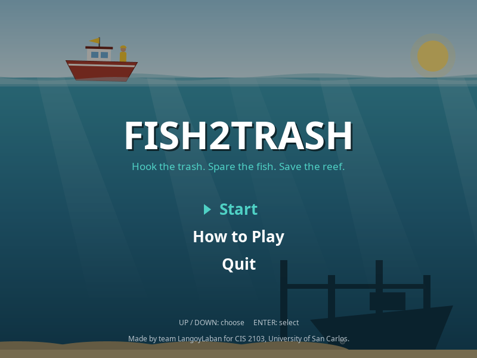
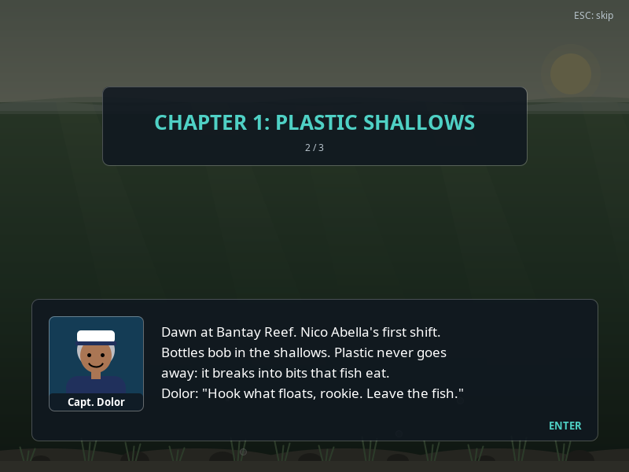
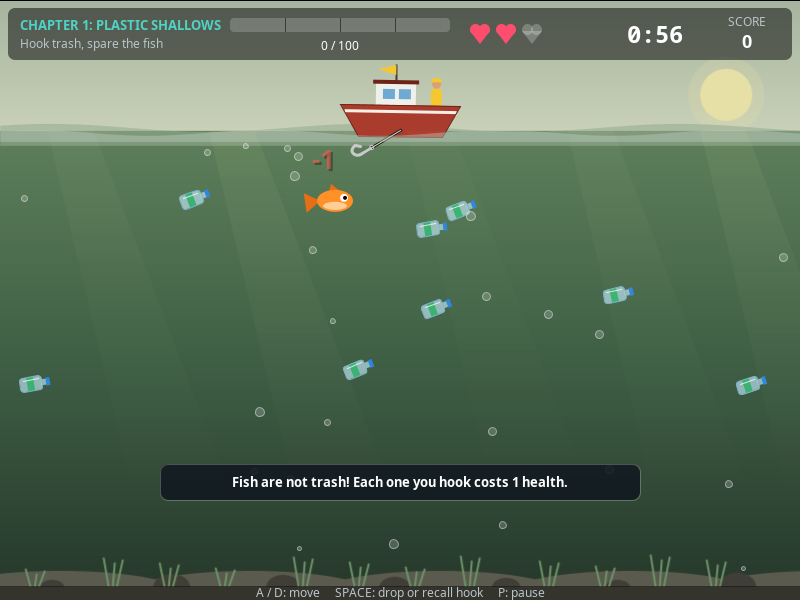
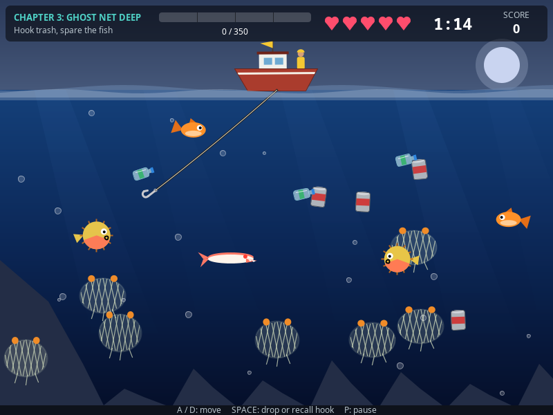

# FISH2TRASH

Hook the trash. Spare the fish. Save the reef.

A 2D story game in Java Swing. You play Nico Abella, the newest member of Captain
Dolor's clean-up crew at Bantay Reef. Each chapter has a quota of trash to collect
before time or health runs out. Clear all three and the reef comes back to life.

| | |
|---|---|
|  |  |
|  |  |

Team project for CIS 2103 (Object Oriented Programming), University of San Carlos.

## Requirements

JDK 17 or newer. Check yours with `java -version`. No libraries needed.

## Run

| | Linux / macOS | Windows |
|---|---|---|
| Play the game | `scripts/run.sh` | `scripts\run.bat` |
| Only compile | `scripts/build.sh` | `scripts\build.bat` |
| Run the tests | `scripts/test.sh` | `scripts\test.bat` |

The scripts work from any folder. They look for a JDK 17+ in `JAVA_HOME` first,
then on the `PATH`, and stop with "Need JDK 17+" if there isn't one.

To build by hand instead, from the project folder:

```bash
mkdir -p out
javac --release 17 -d out $(find src -name '*.java')
java -cp out Main
```

## Controls

| Key | Action |
|---|---|
| `A` / `D` or arrow keys | Move the boat (only while the hook is swinging) |
| `Space` | Drop the hook. Press again while it is going out to pull it back |
| `P` or `Esc` | Pause (resume, restart the chapter, or quit to the menu) |
| `Enter` | Confirm, next story page |
| `Esc` on a story page | Skip the story |
| `Up` / `Down` | Move in menus |

## How to play

| Chapter | Trash to look for | Quota | Time | Health |
|---|---|---|---|---|
| 1. Plastic Shallows | bottles (10 points) | 100 | 65 s | 3 |
| 2. Old Pier Wreck | cans (20), bottles | 200 | 90 s | 4 |
| 3. Ghost Net Deep | fishing nets (50), cans, bottles | 350 | 105 s | 5 |

- Hooking a fish costs 1 health and the fish swims away. Pufferfish and barracuda
  (chapter 3) cost 2. A pufferfish swells when the hook is near; a barracuda
  flashes, then charges.
- Reaching the quota stops the clock. The chapter is cleared when that catch
  reaches the boat.
- Run out of time or health and you are fired. You can retry the chapter;
  chapters you already cleared stay cleared.

## Folder structure

```
FISH2TRASH/
├── src/
│   ├── Main.java            opens the window on the Swing thread
│   ├── model/               the things in the game - no drawing code
│   │   ├── OceanObject      abstract base: position, movement, collision
│   │   ├── OceanTrash       abstract: gives points, rides the hook
│   │   │   └── PlasticBottle, Can, FishingNet
│   │   ├── Fish             abstract: costs health, swims away
│   │   │   └── SmallFish, BigFish, Pufferfish, Barracuda
│   │   ├── ObjectKind       enum: builds each object, lookup key for painters
│   │   ├── ObjectView, HookSensor   small read-only interfaces
│   │   ├── Player, Boat, Hook, TimeLimit
│   │   ├── Equipment, PlainHook, Loadout, CatchOutcome, CatchResolver
│   │   └── Level, ChapterData, SpawnRule, TutorialPrompt   the chapters as data
│   ├── game/                the rules
│   │   ├── GameManager      one chapter attempt: collisions, quota, win/lose
│   │   ├── GameSession      the whole run: current chapter, cleared chapters, retries
│   │   ├── GameView         what the screen may read from a game
│   │   ├── ChapterResult, ChapterStatus, FailCause, SessionStats, GameState
│   │   └── GameEvent, EventType, GameListener   (observer pattern)
│   ├── ui/                  the screens
│   │   ├── GamePanel        frame timer and keyboard
│   │   ├── ScreenManager    which screen is showing, fades between them
│   │   ├── Screen           interface every screen implements
│   │   ├── MainMenu, HowToScreen, StoryScreen, GameScreen, PauseOverlay,
│   │   │   ChapterClearScreen, GameOverScreen, VictoryScreen
│   │   └── render/          SceneRenderer, HudPainter, EffectsSystem, backgrounds and
│   │                        water, one painter per object kind
│   └── util/
│       ├── GameConstants    every tuning number in one place
│       ├── StoryText        every line of text the player reads
│       └── Mathx            clamp, lerp, easing
├── test/                    tests, run by scripts/test
├── docs/                    class diagram, screenshots, proposal notes
├── scripts/                 build, run and test (.sh and .bat)
├── out/                     compiled game (created by the build, not in git)
└── out-test/                compiled tests (not in git)
```

A class diagram is in [docs/class-diagram.md](docs/class-diagram.md).

## How the classes work together

1. `Main` builds a `JFrame` on the event-dispatch thread and adds a `GamePanel`.
2. `GamePanel` runs a `javax.swing.Timer` (~60 fps). Every tick it measures the real
   time since the last tick (`dt`) and passes it, and any fresh key press, to the
   `ScreenManager`. Painting only *reads* the game.
3. `ScreenManager` holds one `Screen` per `GameState` and the `GameSession` (the run).
4. `GameScreen` asks the session for a `GameManager` for the current chapter.
5. `GameManager` owns the `Player`, the `Boat` (which owns the `Hook`), a `TimeLimit`
   and a `Level`. The `Level` reads the chapter's spawn table from `ChapterData` and
   keeps the water stocked.
6. When the hook tip touches an object, the tool on the line (`Equipment`) answers with
   a `CatchOutcome`: catch, slip or pass. The outcome calls back into the manager.
7. On a catch the manager calls `object.onCaught(player, hook)`. Trash adds points and
   attaches itself to the hook; a fish costs health and swims away. The manager never
   checks which one it was.
8. The manager announces what happened as `GameEvent`s to its `GameListener`s
   (the stats counter, and the screen that shows tips).
9. When the chapter ends, the session records a `ChapterResult` and the screens move on:
   report card and next chapter after a clear, pink slip and retry after a fail.

### OOP concepts, and where to point at them

| Concept | Where |
|---|---|
| Encapsulation | Every field is private. `Player` only changes through `addPoints()` and `loseHealth()`, which enforce the rules. Lists are handed out read-only. |
| Inheritance | `OceanObject` → `OceanTrash` → `PlasticBottle`, `Can`, `FishingNet`, and `OceanObject` → `Fish` → `SmallFish`, `BigFish`, `Pufferfish`, `Barracuda`. `Equipment` → `PlainHook`. |
| Abstraction | `OceanObject`, `OceanTrash`, `Fish` and `Equipment` are abstract. `GameView`, `ObjectView`, `HookSensor`, `Screen`, `GameListener`, `CatchResolver` and `ObjectPainter` are interfaces that hide what is behind them. |
| Polymorphism | `object.onCaught(player, hook)`, `object.move(dt)` and `object.sense(hook)` (a pufferfish weaves and swells, a barracuda charges), `tool.attempt(object)`, `outcome.resolve(...)`, `screen.paint(g)`, `painter.paint(...)`: one call, different behaviour per class. |
| Composition | `Boat` owns its `Hook`; the `Hook` carries a `Loadout` of tools; `GameManager` owns a `Level`. |

Patterns used: observer (`GameListener`), template method (`OceanObject.update`,
`Equipment.attempt`), a state machine per screen (`ScreenManager`) and inside
`Hook` and `Barracuda`.

Design rules, checked by `ArchitectureTest` on every test run: `model` and `game` have
no drawing, window or sound imports; nothing uses `instanceof`; no public fields
except constants.

## Testing

`scripts/test.sh` (or `scripts\test.bat`) builds the game and runs every test. The
tests are plain Java classes with a `run()` method, listed in `test/TestRunner.java`;
no test library is needed. The script exits with an error if any check fails.

| Test | What it checks |
|---|---|
| `ArchitectureTest` | The design rules above, by reading the source files |
| `PlayerTest`, `OceanObjectTest`, `BoatHookTest` | Health and score rules, movement, bouncing, collision, the hook's swing, launch and recall |
| `ModelCatchTest`, `DangerousFishTest` | What each kind of object does when hooked; pufferfish and barracuda behaviour |
| `EquipmentTest` | What the hook does to each kind of object, and how a slip plays out |
| `GameEventTest`, `ChapterFlowTest` | The events the game announces; winning, the frozen clock, and both ways to lose |
| `LevelSpawnTest` | Spawn tables: timing, counts, distance from the hook, and enough trash to finish |
| `SessionTest` | Moving on after a clear, retrying after a fail |
| `BalanceBotTest` | A simple computer player must be able to win every chapter at least half the time |
| `StoryTextTest` | Every story page, fail message and tip fits its box |
| `ScreenFlowTest` | Key presses lead to the right screens: menu, story, pause, fired screen, retry |
| `RenderTest`, `EffectsTest`, `MathxTest` | Drawing into an off-screen image, each chapter's look, the bubble and effect pools; the math helpers |

The tests cannot judge how the game feels to play. Use the checklist below for that.

## Manual testing checklist

**Menus and story**
- [ ] The game opens on the menu. Up/Down move, Enter selects.
- [ ] How to Play opens and Enter returns.
- [ ] Start shows the opening and chapter 1 story. Enter finishes a page, then turns it.
- [ ] Esc skips the story.

**Boat and hook**
- [ ] `A`/`D` and the arrow keys move the boat; it stops near both screen edges.
- [ ] The boat cannot move while the hook is out.
- [ ] `Space` launches the hook straight along its swing angle.
- [ ] `Space` again while it is going out pulls it back empty.
- [ ] Holding `Space` down does not pull the hook back by itself.

**Chapter 1**
- [ ] Bottle +10; it rides the hook up and a new one appears.
- [ ] A fish costs 1 health, gives no points, and swims away.
- [ ] Tips appear at about 1, 8 and 16 seconds.
- [ ] At 100 points the timer stops; the chapter clears when the catch reaches the boat.

**Chapter 2**
- [ ] Health 4, time 1:30. Cans are worth 20; most sit low on the right.
- [ ] Big blue fish are clearly faster.

**Chapter 3**
- [ ] Health 5, time 1:45. Nets are worth 50.
- [ ] A pufferfish swells when the hook is near. Hooking it costs 2.
- [ ] A barracuda flashes, then charges. Hooking it costs 2.
- [ ] Clearing it shows the ending, then the shift report, then the menu.

**Losing and pausing**
- [ ] Time running out shows the pink slip with a "tide" or "time" message.
- [ ] Health reaching 0 shows the pink slip with a "fish" message.
- [ ] Enter retries the same chapter; Esc returns to the menu.
- [ ] `P` or `Esc` pauses. Resume, Restart chapter and Quit to menu all work.
- [ ] Clicking another window pauses the game.

## Team

LangoyLaban, BSIT 2.

| Member | Area |
|---|---|
| Matthew Llenos | Player, chapters and levels, game manager and session, timer, win and lose, HUD, story |
| Arjoe R. Marata | Boat, hook and tools, controls, collision, screens and animation |
| Neil Villarito | Ocean objects, trash and fish classes, spawning, object painters |

## Credits

Everything on screen is drawn in code with Java2D, and all text is written by the
team. The game uses no external images, fonts, sounds or libraries.

## Contributing

- Work on a branch, not on `main`. Name it `<type>/<short-name>`, for example
  `feat/boat-movement` or `fix/hook-collision`.
- Run the tests before you commit (`scripts/test.sh` or `scripts\test.bat`).
  The build must finish with no warnings.
- Keep commits small, one change each. Start the message with a type and write
  it as an instruction, in lowercase: `feat: add boat movement`,
  `fix: stop hook passing through cans`. Types: `feat`, `fix`, `refactor`,
  `test`, `docs`, `chore`, `build`.
- Push your branch and open a pull request into `main`, then ask a teammate to
  review it.
