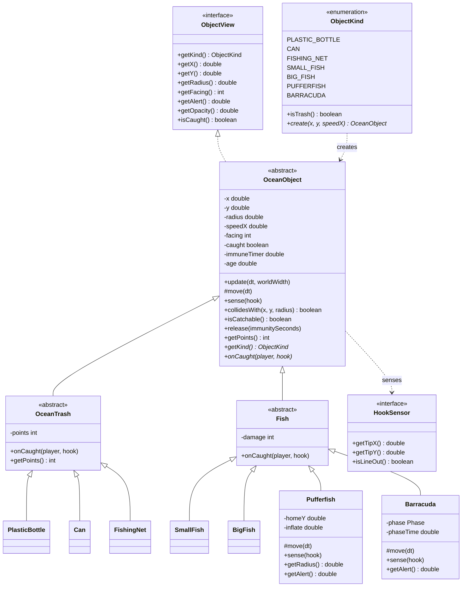
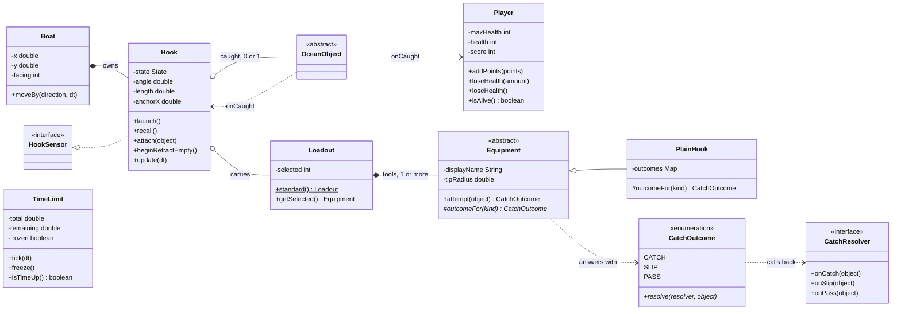
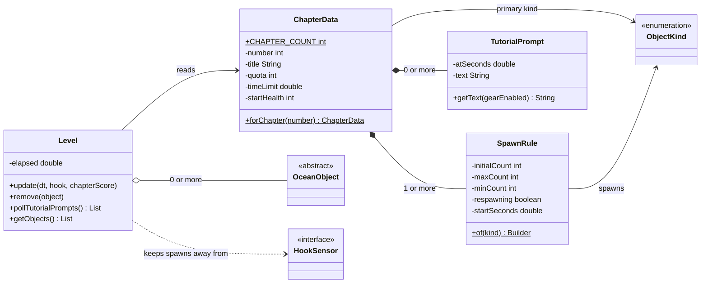
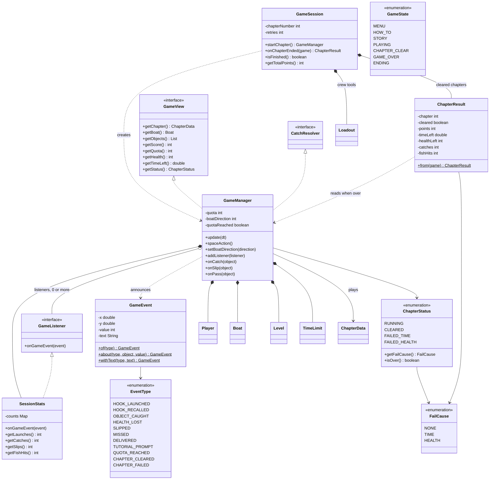
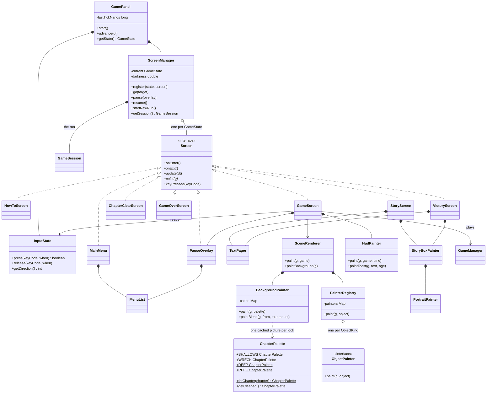

# Class diagram

The diagrams below are drawn from the code as it is now. `DiagramTest` (run by
`scripts/test`) fails if a class in `src/` is missing from this page, or if this
page names a class that no longer exists, so the page cannot quietly go out of date.

To keep the pictures readable, each one shows a part of the game, and getters and
setters are left out.

On GitHub a large diagram is shown cropped. Use the buttons at its top right corner
to zoom, move around, or open it at full size.

**How to read them**

| Arrow | Meaning | Example |
|---|---|---|
| `A <\|-- B` solid line, hollow triangle | B **extends** A (inheritance) | `OceanTrash <\|-- Can` |
| `A <\|.. B` dashed line, hollow triangle | B **implements** interface A | `GameListener <\|.. SessionStats` |
| `A *-- B` filled diamond | A **owns** B; B is created by A and lives with it (composition) | `Boat *-- Hook` |
| `A o-- B` hollow diamond | A **holds** B, but B is made elsewhere (aggregation) | `Hook o-- Loadout` |
| `A ..> B` dashed arrow | A **uses** B for a moment (dependency) | `ObjectKind ..> OceanObject` |

`+` public, `-` private, `#` protected. *Italic* names and a `*` after a method mean abstract.

## 1. Things in the ocean (package `model`)

The inheritance tree. `onCaught`, `move` and `sense` are the polymorphic methods:
the game calls them on an `OceanObject` and each subclass answers in its own way.

## 2. Player, boat, hook and tools (package `model`)

## 3. Chapters and levels (package `model`)

A chapter is data. `Level` reads it and keeps the water stocked.

## 4. The rules (package `game`)

`GameManager` plays one chapter attempt. `GameSession` remembers the whole run.
The manager announces `GameEvent`s to its listeners (the observer pattern).

## 5. Screens (packages `ui` and `ui.render`)

`ScreenManager` keeps one `Screen` for each `GameState` and shows one at a time.

`ObjectPainter` has one implementation for each `ObjectKind`: `BottlePainter`,
`CanPainter`, `NetPainter`, `SmallFishPainter`, `BigFishPainter`, `PufferPainter`
and `BarracudaPainter`.

## Classes without a box

These hold shared constants or helpers and have no relationships worth drawing:

- `Main` opens the window and starts the `GamePanel`.
- `GameConstants` holds every tuning number, `StoryText` every line of text,
  and `Mathx` a few math helpers (package `util`).
- `Fonts`, `UiPalette` and `TextDraw` hold the fonts, colours and text-placing
  helpers the screens share (package `ui.render`).
